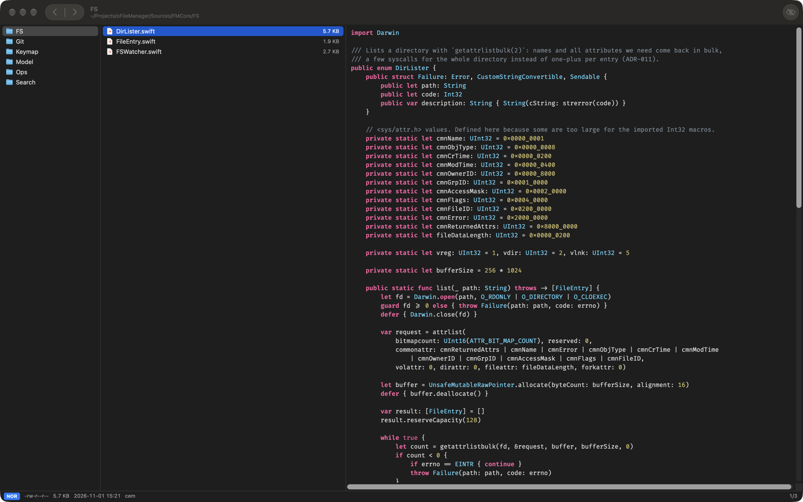

# FileMaster

A very fast, keyboard-first file manager for macOS on Apple Silicon. It looks and feels like a native Mac app
and works like [yazi](https://yazi-rs.github.io): three columns (parent | current | preview), a preview for every
file, and vim-style keys, with arrow keys and the usual ⌘ shortcuts too.



## Features

- **Fast listing.** Directories are read with `getattrlistbulk(2)` (a few syscalls per directory instead of one or
  more per file) and drawn by custom AppKit views. A 10k-entry folder lists and sorts in ~12 ms on an M1 Pro.
  FSEvents keeps every column live.
- **Miller-column layout** with resizable panes (drag the dividers, or `⌥←`/`⌥→` and `⌃←`/`⌃→`) that redraw in
  real time.
- **Previews for everything:**
  - syntax-highlighted code for about 35 languages (Swift, C/C++, Rust, Go, Python, JS/TS, XML/HTML/plist, JSON,
    YAML, TOML, shell, SQL, Markdown…), shown in Fira Code at an adjustable size (`⌘+` / `⌘−`)
  - images, video and audio posters with codec info, and QuickLook for Office/iWork files
  - a hex view as the fallback for any other binary file
- **Built-in viewer and player** on `Space`:
  - video: `←`/`→` seek ±10 s, `1`–`9` jump to 10–90 %, `Space` play/pause, `F` instant borderless full screen
    (no macOS animation)
  - PDF and image zoom (`⌘+` `⌘−` `⌘0`, pinch, drag to pan)
- **File operations** run in the background with a task list (`w`):
  - yank/cut/paste (APFS clones), trash or permanent delete, create, rename, symlink, open with…
  - Finder copy/paste works both ways through the pasteboard.
- **Search and navigation:**
  - incremental find (`/` `n` `N`) and a live filter (`f`)
  - recursive fuzzy name search (`s`) and content search via ripgrep (`S`)
  - frecent-folder jump (`z`), bookmarks (`b<c>` / `'<c>`), history
- **Tabs** as native macOS window tabs (`t`, `1`–`9`, `[` `]`).
- **Git status** markers (M/A/?/D/R/U) next to files and folders.
- **Configurable keys** through `~/.config/filemaster/keymap.toml` (yazi syntax), and a which-key popup for
  multi-key sequences.

## Install

Download the DMG from [Releases](../../releases), drag **FileMaster** to Applications, then run this once:

```sh
xattr -dr com.apple.quarantine /Applications/FileMaster.app
```

Releases are ad-hoc signed, not notarized, so Gatekeeper blocks the first launch until the quarantine flag is
removed. See [docs/DISTRIBUTION.md](docs/DISTRIBUTION.md).

**Requirements:** macOS 27+ and an Apple Silicon Mac. Optional: `ripgrep` for faster content search
(`brew install ripgrep`).

## Build from source

Requires Xcode 27.2 (Swift 6.4).

```sh
make app      # release build → build/FileMaster.app
make run      # debug build and launch
make test     # unit tests (Swift Testing)
make bench DIR=/some/large/folder   # listing/sort benchmarks
make dist     # signed DMG → dist/
```

The project is pure SwiftPM, with no `.xcodeproj`. Open `Package.swift` in Xcode to debug.

## Keys at a glance

| Keys | Action |
|---|---|
| `↑↓←→` / `hjkl` | move; `→`/`l` only enters folders |
| `Space` | open the viewer/player |
| `Enter` / `o` | open with the default app |
| `Tab`, `v`, `⌘A` | select, visual mode, select all |
| `y` `x` `p` | copy, cut, paste |
| `d` / `D` | move to Trash / delete permanently |
| `a` / `r` | create (a trailing `/` makes a folder) / rename |
| `/` `f` `s` `S` `z` | find, filter, name search, content search, jump |
| `.` | show/hide hidden files |
| `~` or `F1` | searchable help for all keys |

The full list is in [docs/KEYMAP.md](docs/KEYMAP.md).

## Documentation

| Doc | Contents |
|---|---|
| [ARCHITECTURE](docs/ARCHITECTURE.md) | modules, threading, data flow, performance budgets |
| [DECISIONS](docs/DECISIONS.md) | architecture decision records |
| [PREVIEW](docs/PREVIEW.md) | preview pipeline and per-type previewers |
| [MEDIA](docs/MEDIA.md) | image viewer and video player |
| [KEYMAP](docs/KEYMAP.md) | default bindings and `keymap.toml` format |
| [CONFIG](docs/CONFIG.md) | config locations and schema |
| [PLUGINS](docs/PLUGINS.md) | plugin SDK design (planned) |
| [DISTRIBUTION](docs/DISTRIBUTION.md) | signing, DMG, notarization |
| [ROADMAP](docs/ROADMAP.md) | milestones and current status |

## Status

Early (v0.1). Navigation, previews, viewer, file operations, tabs, search, git status and bookmarks work.
Planned items are tracked in the [roadmap](docs/ROADMAP.md):
- an FFmpeg playback backend for MKV/WebM/AVI
- native Swift plugin bundles (`.fmplugin`)
- drag & drop with Finder
- bulk rename and shell commands

## License

[MIT](LICENSE). Bundles [Fira Code](https://github.com/tonsky/FiraCode) under the SIL Open Font License.
